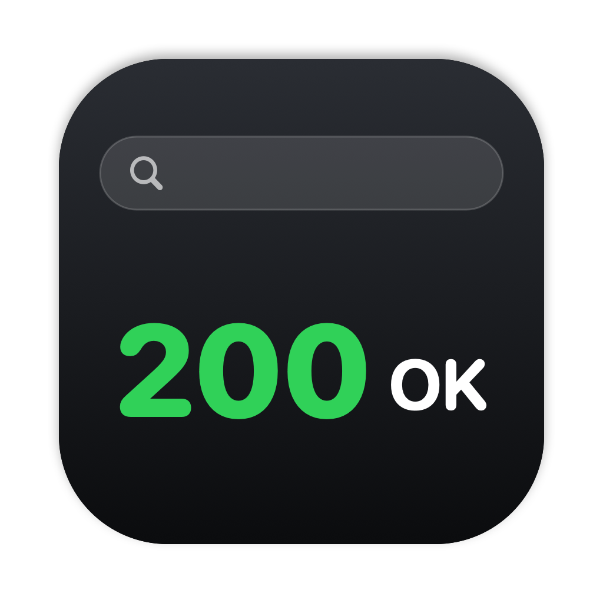
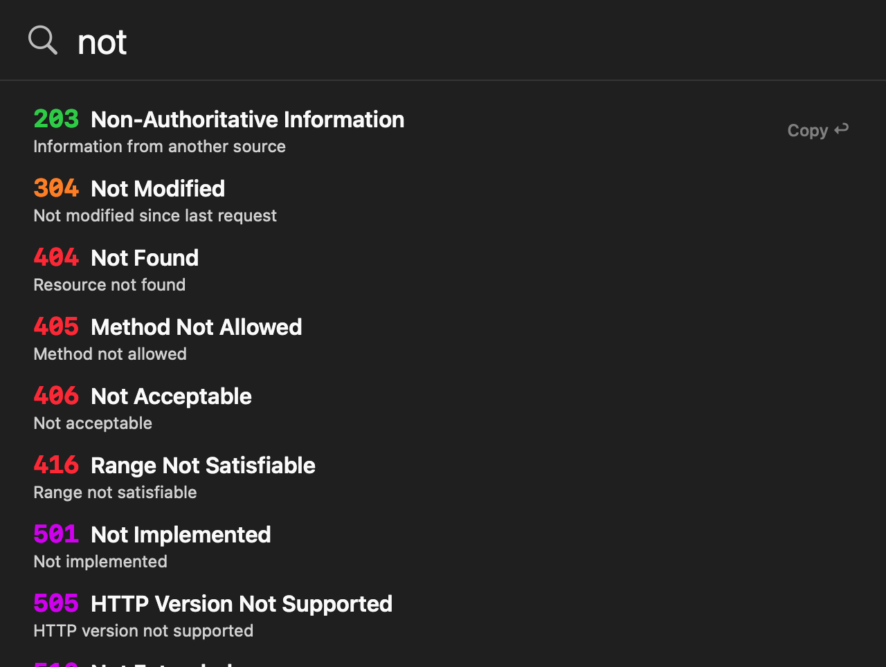
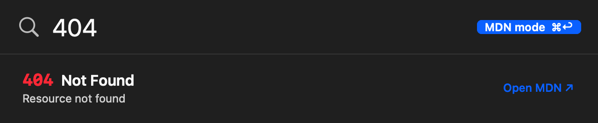
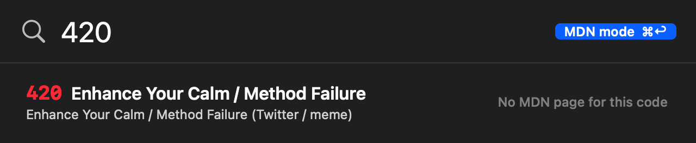

<div align="center">



# CodeSpot

**Spotlight-style HTTP status code lookup for macOS.**

Press a shortcut, type `404` or `not found`, and see the code, its name and what it means as you type.<br>
Native · Liquid Glass · works offline · about 20 MB of memory

[](https://github.com/Mujtaba1i/CodeSpot/releases/latest)
[](#install)
[](#install)
[](#building-from-source)
[](LICENSE)



</div>

## Highlights

| | |
| --- | --- |
| **Feels like Spotlight**<br>A Liquid Glass bar opens where Spotlight does, pops in with a little bounce, and grows downward as results appear. | **Live search**<br>Search by code (`404`, `5`) or by words (`not found`). Codes that start with what you typed come first. |
| **Color-coded**<br>1xx blue, 2xx green, 3xx orange, 4xx red, 5xx purple, with the name beside the code and the meaning below. | **86 codes**<br>The everyday standard codes, plus well-known ones from nginx, Cloudflare, IIS, Laravel and Shopify. |
| **Copy in one key**<br>`↩` copies `404 Not Found` and closes. | **MDN docs**<br>Hold `⌘` and press `↩` to open the code's MDN page. Codes MDN doesn't cover say so. |
| **Your shortcut**<br>`⌃⌥Space` by default. CodeSpot warns you if macOS already uses the one you pick. · new | **Private**<br>No network access and no analytics. Only your browser goes online, when you open MDN. |

`Esc`, clicking elsewhere or opening Spotlight closes it. CodeSpot lives in the menu bar (or hidden), remembers where you drag it, and can start at login.

<div align="center">

| MDN mode | Code without an MDN page |
| :---: | :---: |
|  |  |

</div>

## Install

1. Download `CodeSpot.dmg` from [Releases](https://github.com/Mujtaba1i/CodeSpot/releases/latest).
2. Open it and drag **CodeSpot** into **Applications**.
3. The first time, right-click CodeSpot and choose **Open**. It isn't notarized, so macOS asks once.

Needs macOS 14 Sonoma or newer, on Apple silicon or Intel. Liquid Glass needs macOS 26; older versions get the classic blur.

## Usage

| To | Do |
| --- | --- |
| Open or close CodeSpot | `⌃⌥Space` |
| Search | Type a code or words. Type a space to list every code. |
| Copy `404 Not Found` | `↑` / `↓` to select, then `↩` or click |
| Open the MDN page | Hold `⌘` and press `↩` or click |
| Open Settings | `⌘ + ,` in the panel, or menu bar icon › **Settings…** |
| Move the panel | Drag it by its edge. Menu bar › **Reset Panel Position** puts it back. |

**Settings:** the shortcut, the key that opens MDN (`⌘`, `⌥`, `⌃` or `⇧`), launch at login, and whether the menu bar icon shows. With the icon hidden, `⌘ + ,` in the panel still opens Settings.

## Troubleshooting

<details>
<summary><b>"CodeSpot can't be opened" or "is damaged"</b></summary>

That's Gatekeeper, because the app isn't notarized. Right-click it in Applications and choose **Open**, or run:

```bash
xattr -dr com.apple.quarantine /Applications/CodeSpot.app
```

</details>

<details>
<summary><b>The shortcut doesn't open anything, or it switches my keyboard language</b></summary>

macOS's own shortcuts always win over apps. The usual culprit is **Select next source in Input menu**, which is `⌃⌥Space` once you have more than one keyboard language. Pick another shortcut in CodeSpot's **Settings** (it warns you about clashes), or turn the macOS one off in **System Settings › Keyboard › Keyboard Shortcuts › Input Sources**.

You can always open the panel from the menu bar icon, or by opening CodeSpot again from Finder or Spotlight.

</details>

<details>
<summary><b>Launch at login doesn't stick</b></summary>

Move CodeSpot to **Applications** first, then turn the setting off and on again. macOS remembers where the app was when you turned it on.

</details>

## Building from source

<details>
<summary>CodeSpot is plain Swift and AppKit. The Xcode Command Line Tools are enough. Show the steps.</summary>

```bash
xcode-select --install          # once
git clone https://github.com/Mujtaba1i/CodeSpot.git
cd CodeSpot
./build.sh                      # -> CodeSpot.app  (UNIVERSAL=1 for arm64 + x86_64)
.build/release/CodeSpot --selftest
open CodeSpot.app
```

To try a change, rebuild and restart the running copy: `./build.sh && pkill -x CodeSpot; open CodeSpot.app`.

Other tools: `./make-dmg.sh` makes `CodeSpot.dmg`, `swift tools/make-icon.swift` redraws the icon, and `CodeSpot --snapshot "404" out.png [--mdn]` renders the results view to a PNG.

**Releases:** GitHub Actions builds a universal DMG and publishes a release only when you push a version tag (`git tag v1.1.0 && git push origin v1.1.0`). Normal pushes run nothing. The release notes list every commit since the previous tag.

**Project layout**

```
Sources/CodeSpot/
├── main.swift         startup, --selftest and --snapshot
├── HTTPCodes.swift    the codes, search and MDN links (self-tested)
├── SearchView.swift   search field, results list, MDN mode
├── Panel.swift        the floating glass panel, animations, positioning
├── App.swift          menu bar, global shortcut, shortcut recorder
├── HotKey.swift       global hotkey and macOS clash check (self-tested)
└── Settings.swift     the Settings window
Resources/             Info.plist and the app icon
tools/make-icon.swift  draws the icon
```

</details>

## Roadmap

CodeSpot starts with HTTP status codes, and is meant to grow into a small, fast launcher you can extend.

- [x] Warn about shortcuts macOS already uses
- [ ] **Extensions:** your own lookups in Python or C, in the spirit of [Albert](https://albertlauncher.github.io)
- [ ] Signed and notarized releases, with no Gatekeeper prompt

Missing a code, or have an idea? [Open an issue](https://github.com/Mujtaba1i/CodeSpot/issues).

## Contributing

Bug reports, ideas and pull requests are all welcome. Please run `./build.sh && .build/release/CodeSpot --selftest` before opening a pull request, and write clear commit messages: they become the release notes.

## Acknowledgements and license

Inspired by Apple's Spotlight. CodeSpot is an independent project and is not affiliated with or endorsed by Apple. Status codes and descriptions come from [albert-httpstatus](https://github.com/Mujtaba1i/albert-httpstatus), and documentation links point to [MDN Web Docs](https://developer.mozilla.org/en-US/docs/Web/HTTP/Reference/Status).

[MIT](LICENSE) © 2026 Mujtaba1i
