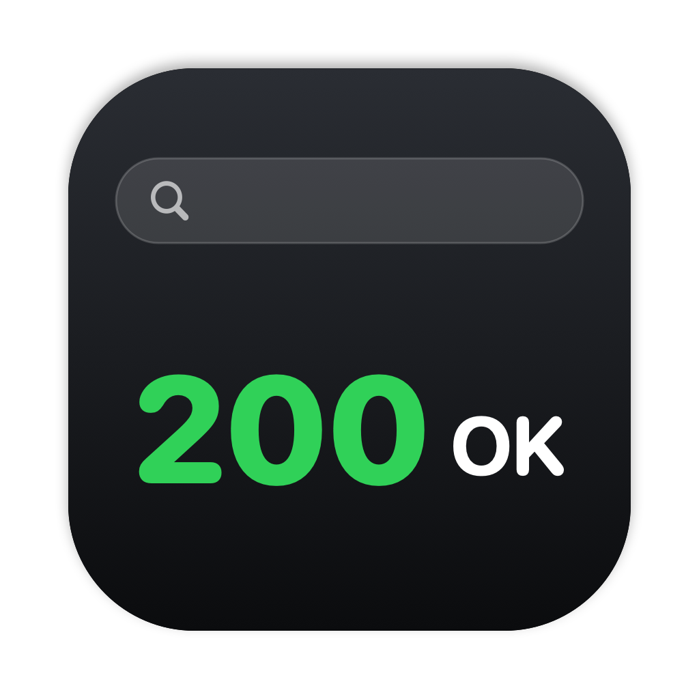
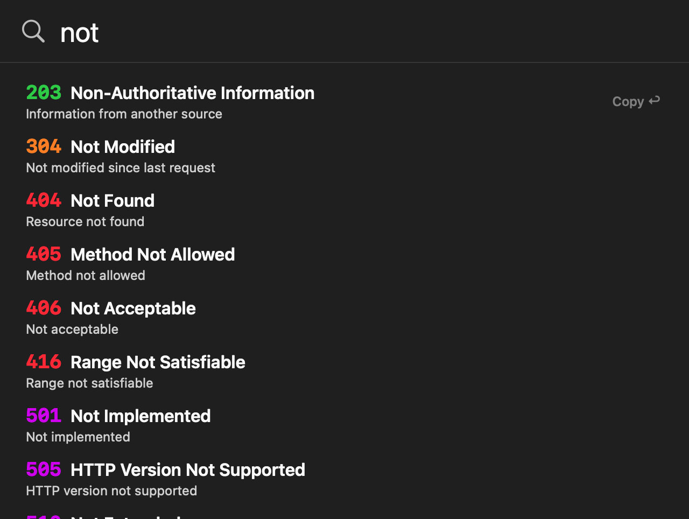
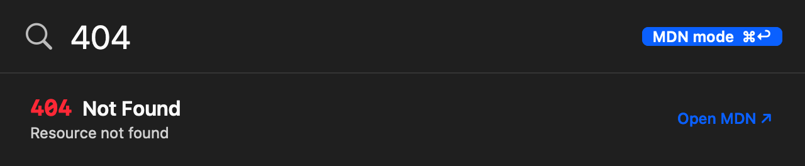
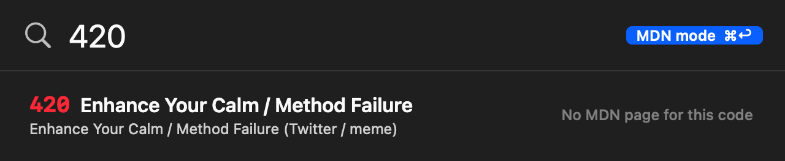

<div align="center">



# CodeSpot

**Spotlight-style HTTP status code lookup for macOS.**

Press a shortcut, type `404` or `not found`, and get the code, its name and a one-line description, all while you type.<br>
Native, **fully offline**, about **20 MB** of memory, no dependencies.

[](https://github.com/Mujtaba1i/CodeSpot/releases/latest)
[](#installation)
[](#installation)
[](#building-from-source)
[](LICENSE)



</div>

## Features

- **Spotlight look and feel.** A Liquid Glass search bar opens where Spotlight does, pops in with the same little bounce, and grows downward as results appear.
- **Live search.** Results update on every keystroke. Search by code (`404`, `5`) or by words (`not found`, `server error`). Codes that start with what you typed come first, so `5` lists 5xx before 205.
- **Color-coded.** 1xx blue, 2xx green, 3xx orange, 4xx red, 5xx purple. The name sits next to the code, with the description in smaller text below.
- **86 codes.** The everyday standard codes, plus well-known unofficial codes from nginx, Cloudflare, IIS, Laravel and Shopify. Leave the field empty for a clean bar, or type a space to list them all.
- **Copy in one key.** `↩` copies `404 Not Found` to the clipboard and closes.
- **Open MDN docs.** Hold `⌘` (or the modifier you choose) to switch into MDN mode, then press `↩` to open the code's MDN page in your browser. Codes MDN doesn't cover say so.
- **Your shortcut.** The default is `⌃⌥Space`, and you can change it to anything in Settings.
- **Stays out of your way.** Closes when you click elsewhere or open Spotlight, remembers where you drag it, can launch at login, and can hide its menu bar icon.
- **Light and private.** No network access, no analytics. Only your browser goes online, when you ask it to open MDN.

<div align="center">

|                              MDN mode                              |                               Code without an MDN page                               |
| :----------------------------------------------------------------: | :----------------------------------------------------------------------------------: |
|  |  |

</div>

## Installation

1. Download `CodeSpot.dmg` from the [Releases page](https://github.com/Mujtaba1i/CodeSpot/releases/latest).
2. Open it and drag **CodeSpot** into **Applications**.
3. The first time, **right-click CodeSpot › Open**. The app is ad-hoc signed but not notarized, so macOS asks once.

A small list icon appears in the menu bar. Press `⌃⌥Space` and start typing.

Requires macOS 14 Sonoma or newer. It runs natively on Apple silicon and Intel. Liquid Glass needs macOS 26; older versions get the classic blur.

## Usage

| Action                 | How                                                                   |
| ---------------------- | --------------------------------------------------------------------- |
| Open or close CodeSpot | `⌃⌥Space` (configurable)                                              |
| Search                 | Type a code or words                                                  |
| List every code        | Type a space                                                          |
| Move the selection     | `↑` / `↓`                                                             |
| Copy `404 Not Found`   | `↩` or click                                                          |
| Open the MDN page      | Hold `⌘` (configurable) and press `↩` or click                        |
| Close                  | `Esc`, click elsewhere, or open Spotlight                             |
| Settings               | `⌘ + ,` in the panel, or menu bar icon › **Settings…**                |
| Move the panel         | Drag it by its edge. Menu bar › **Reset Panel Position** puts it back |

### Settings

- **Shortcut:** click the button, then press the new combination. It must include `⌘`, `⌃` or `⌥`.
- **Open MDN with:** `⌘`, `⌥`, `⌃` or `⇧` + `↩`.
- **Launch CodeSpot at login**
- **Show icon in menu bar:** when it's hidden, `⌘ + ,` in the panel still opens Settings.

## Troubleshooting

<details>
<summary><b>"CodeSpot can't be opened" or "is damaged"</b></summary>

That's Gatekeeper, because the app isn't notarized. Right-click it in Applications and choose **Open**, or run:

```bash
xattr -dr com.apple.quarantine /Applications/CodeSpot.app
```

</details>

<details>
<summary><b>The shortcut doesn't open anything</b></summary>

Another app may already own that combination. In that case CodeSpot tells you when you set it and keeps the previous one. Pick a different shortcut in **Settings**. You can always open the panel from the menu bar icon, or by opening CodeSpot again from Finder or Spotlight.

</details>

<details>
<summary><b>Launch at login doesn't stick</b></summary>

Move CodeSpot to **Applications** first, then turn the setting off and on again. macOS registers the app at its current location, so a copy in Downloads or on the Desktop can stop working once it's moved.

</details>

<details>
<summary><b>I hid the menu bar icon and can't find Settings</b></summary>

Open the panel with your shortcut and press `⌘ + ,`.

</details>

## Building from source

CodeSpot is plain Swift and AppKit, built with Swift Package Manager. The Xcode **Command Line Tools** are enough; you don't need full Xcode.

```bash
xcode-select --install          # once
git clone https://github.com/Mujtaba1i/CodeSpot.git
cd CodeSpot
./build.sh                      # -> CodeSpot.app  (UNIVERSAL=1 for arm64 + x86_64)
open CodeSpot.app
```

Other scripts:

```bash
.build/release/CodeSpot --selftest                       # search logic checks
.build/release/CodeSpot --snapshot "404" out.png [--mdn] # render the results view to a PNG
./make-dmg.sh                                            # -> CodeSpot.dmg
swift tools/make-icon.swift                              # regenerate Resources/AppIcon.icns
```

To try a change, rebuild and restart the running copy: `./build.sh && pkill -x CodeSpot; open CodeSpot.app`.

Every push and pull request builds a universal DMG with GitHub Actions. Pushing a `v*` tag (for example `git tag v1.0 && git push --tags`) also publishes it as a GitHub release.

<details>
<summary>Project layout</summary>

```
Sources/CodeSpot/
├── main.swift         startup, --selftest and --snapshot
├── HTTPCodes.swift    the codes, search and MDN links (self-tested)
├── SearchView.swift   search field, results list, MDN mode
├── Panel.swift        the floating glass panel, animations, positioning
├── App.swift          menu bar, global shortcut, shortcut recorder
├── HotKey.swift       global hotkey (Carbon, no permissions needed)
└── Settings.swift     the Settings window
Resources/             Info.plist and the app icon
tools/make-icon.swift  renders the icon
```

</details>

<details>
<summary>Moving your clone to another Mac</summary>

The full history lives in the hidden `.git` folder, so a zip of the project keeps every commit.

```bash
cd ..
zip -r CodeSpot.zip CodeSpot -x "CodeSpot/.build/*" "CodeSpot/CodeSpot.app/*" "CodeSpot/CodeSpot.dmg"
```

Unzip it on the other Mac and run `git log --oneline` to check the history came along. To commit under a different name or email from then on, without changing any existing commit, run this inside the folder:

```bash
git config user.name  "Your Name"
git config user.email "you@example.com"
```

Earlier commits keep their original author. Changing them would rewrite every commit hash.

</details>

## Roadmap

CodeSpot starts with HTTP status codes, but it's built to become a small, fast launcher you can extend.

- [ ] **Extensions:** write your own lookups in Python or C, in the spirit of [Albert](https://albertlauncher.github.io)
- [ ] Signed and notarized releases, so there's no Gatekeeper prompt

Ideas and feedback are very welcome. [Open an issue](https://github.com/Mujtaba1i/CodeSpot/issues).

## Contributing

Bug reports, ideas and pull requests are all welcome.

- Please run `./build.sh && .build/release/CodeSpot --selftest` before opening a pull request.
- Write clear commit messages.

## Acknowledgements

The look and behavior are inspired by Apple's Spotlight. CodeSpot is an independent project and is not affiliated with or endorsed by Apple.

Status codes and descriptions come from [albert-httpstatus](https://github.com/Mujtaba1i/albert-httpstatus). Documentation links point to [MDN Web Docs](https://developer.mozilla.org/en-US/docs/Web/HTTP/Reference/Status).

## License

[MIT](LICENSE) © 2026 Mujtaba1i
